# Zotero Scholar Suite

把 **Better Notes for Zotero** 和 **Translate for Zotero** 合成一个插件，并新增「保留图片的全文翻译（含图内文字翻译）」和「模型源管理器」。可以和官方 **Ethereal Style** 一起用，组成三合一。

**下载：<https://github.com/wengu4765-lang/zotero-scholar-suite/releases/tag/v1.1.0>**（附件 `zotero-scholar-suite-lite-1.1.0.xpi`；以后的版本见 [Releases](https://github.com/wengu4765-lang/zotero-scholar-suite/releases)）

## 安装（先看这里）

> 需要 **Zotero 8 及以上**（准确地说是 Zotero 8.0-beta.21 至 10.\*，实测 Zotero 10.0.6）。**Zotero 7 装不上**，请先升级 Zotero。

1. **先卸载原来的三个插件**：Zotero 菜单「工具 → 插件」，把 **Better Notes for Zotero**、**Translate for Zotero** 逐个「禁用」再「移除」。如果装过 **Ethereal Style**，见下面第 4 步再决定是否保留。
   你的笔记、翻译设置和 API Key 存在 Zotero 的数据和偏好里，移除插件不会删掉它们，套件会继续沿用。
2. 从 [Release 页面](https://github.com/wengu4765-lang/zotero-scholar-suite/releases/tag/v1.1.0) 下载 `zotero-scholar-suite-lite-1.1.0.xpi`。
3. 在插件窗口点右上角齿轮 ⚙ →「**从文件安装插件…**」，选择下载的 xpi，然后**重启 Zotero**。重启后「设置」左侧出现「翻译」和「Better Notes」两个页面，就是装好了。
4. **想要三合一效果**（条目列表美化、阅读进度等）：再从作者官方发布页安装 **Ethereal Style**（<https://github.com/MuiseDestiny/zotero-style/releases>，本套件以 6.0.8 测试）。套件会自动兼容：不报冲突、不弹窗，「设置」里会多出 Style 页面，Style 里调用的翻译走套件的翻译服务。已经装着官方 Style 的，保留即可。
   也可以在本地用 `python3 build.py --with-style` 自己构建一个内置 Style 的完整版（见第 7 节），只供自用。

如果忘了卸载原来的 Better Notes / Translate，套件启动时会弹窗提示，并自动跳过对应的内置模块（不会重复加载）。按提示禁用原插件、重启即可。

更新：插件带有在线更新源（指向本仓库的 `update.json`），之后的版本 Zotero 会在「检查更新」时自动发现；也可以手动下载新 xpi 覆盖安装。

---

| 组成 | 版本 | 说明 |
|---|---|---|
| Better Notes for Zotero | 3.3.3 | 笔记增强（大纲、双链、模板、导出等），功能与官方版一致 |
| Translate for Zotero | 2.4.8 | 划词翻译、注释/标题/摘要翻译等，功能与官方版一致，另加下面几项新功能 |
| **新增：模型源管理器** | — | 像 CC Switch 一样集中管理多个大模型 / 翻译 API，一键切换 |
| **新增：全文翻译（保留图片）** | — | 整篇 PDF 翻译成中英对照的 HTML，图、表、公式以截图保留在原位置 |
| **1.1.0 新增：图内文字翻译** | — | 把图片、图表里的文字翻成中文，以可切换的译文叠层盖在原图上（原图不重绘）；位图可选用识图模型做 OCR |
| Ethereal Style（可选） | 6.0.8 | **不包含在本仓库和 Lite 版中**。请单独安装官方版，或本地 `--with-style` 构建 |

插件 ID：`zotero-scholar-suite@hark.local`

## 1. 兼容性

- **支持：Zotero 8.0-beta.21 至 Zotero 10.\***（实测 Zotero 10.0.6，Linux arm64）。
- **不支持 Zotero 7**：Better Notes 3.3.3 本身要求 Zotero ≥ 8.0-beta.21，所以套件也无法装在 Zotero 7 上。
- 插件是纯 JavaScript，与操作系统无关，Windows / macOS / Linux 都应可用（目前只在 Linux 上实测）。

## 2. Lite 版与完整版

| | Lite 版（Release 下载） | 完整版（本地构建） |
|---|---|---|
| 构建命令 | `python3 build.py` | `python3 build.py --with-style` |
| 文件名 | `zotero-scholar-suite-lite-1.1.0.xpi` | `zotero-scholar-suite-full-1.1.0.xpi` |
| 内容 | Better Notes + Translate + 新功能 | 以上 + 官方 Ethereal Style 6.0.8（原样，未修改） |
| Ethereal Style | 另行安装官方版，自动兼容 | 内置；构建时从作者 GitHub Releases 下载并校验 sha256 |
| 自动更新 | 有（本仓库 `update.json`） | 无（避免被自动“更新”成不含 Style 的 Lite 版） |
| 分发 | 公开 | **仅供自用，请勿再分发**（Ethereal Style 6.x 不开源，版权归原作者） |

两个版本插件 ID 相同，互相覆盖安装。从完整版换成 Lite 版后 Style 会随之消失，需要再单独安装官方 Ethereal Style。

---

## 3. 模型源管理器

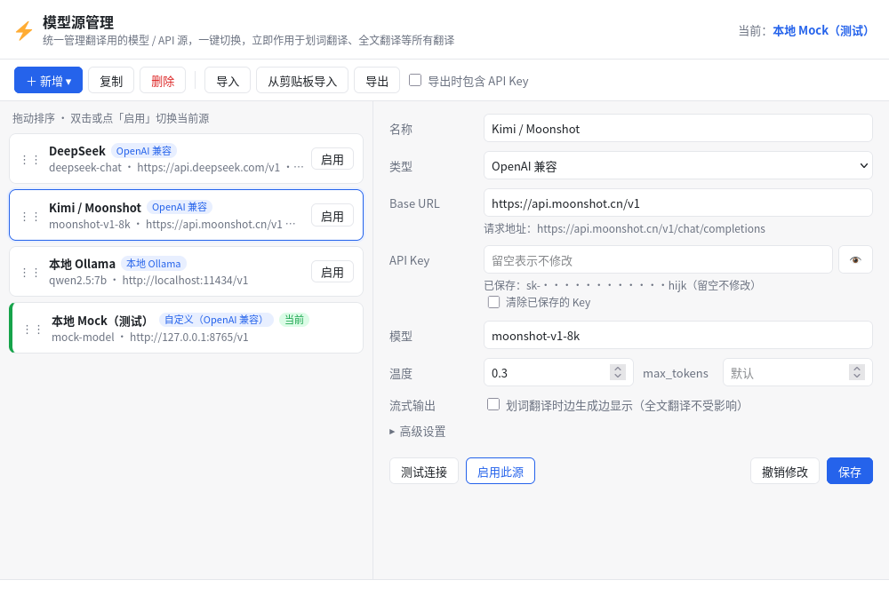

### 3.1 打开方式（任选其一）

- 快捷键 **Alt + Shift + M**
- 菜单「工具 → Scholar Suite：模型源管理…」
- 主窗口右上角的翻译图标按钮 → 「管理模型源…」
- 「设置 → 翻译」页面里的「打开模型源管理…」按钮
- PDF 阅读器顶部工具栏的模型源下拉框 → 「管理模型源…」

### 3.2 新增源：预设模板

点「**＋ 新增 ▾**」，从预设模板中选一个，系统会自动填好地址和默认模型，你只需要填 API Key：

OpenAI、DeepSeek、Kimi / Moonshot、通义千问 DashScope、智谱 GLM、硅基流动 SiliconFlow、OpenRouter、Claude (Anthropic)、Google Gemini、本地 Ollama、DeepL API Free、自定义 OpenAI 兼容。

每个源可以设置：名称、类型、Base URL（下方会实时显示实际请求地址）、API Key、模型、温度、max_tokens、是否流式输出；「高级设置」里还有自定义请求参数（JSON）、额外请求头（JSON）、自定义提示词（必须包含 `${sourceText}`）和备注。改完点「**保存**」。

API Key 和原插件其他服务的 Key 存在同一个地方，列表中只显示打码后的形式（如 `sk-••••hijk`）。

### 3.3 启用与切换

- **只有点「启用」才会切换**：在列表里点某个源右侧的「启用」（或双击该源、或编辑区的「启用此源」），翻译服务才会切到这个源。
- 被启用的源左侧有绿色竖条和「**当前**」标签，窗口右上角显示「当前：xxx」。
- 新增、复制、导入源都**不会**自动切换；还没启用任何源时，不显示「当前」标记，翻译仍走你原来选的服务。
- 如果你在「设置 → 翻译 → 翻译服务」里改选了别的服务（例如 Google），「当前」标记会自动消失，与实际一致。
- 删除正在使用的源时，翻译服务会退回到免费的内置服务（中文界面为 CNKI），不会悄悄换成列表里的另一个源。
- 启用后立即生效于：划词翻译、阅读器翻译面板、注释/标题/摘要翻译、Ethereal Style 中调用的翻译（如已安装 Style）、全文翻译。
- 源配置和当前源保存在 Zotero 偏好中，**重启后保持不变**。
- 列表可以拖动排序；「复制」可快速做一个参数不同的副本。

### 3.4 测试连接

选中一个源，点「**测试连接**」：会用它翻译一句英文测试句，显示是否成功、耗时和返回结果；失败时显示错误信息（如 401 Key 错误、地址不通）。测试不需要先启用。

### 3.5 导入 / 导出

- 「**导出**」：保存为 JSON 文件。默认**不含** API Key；勾选「导出时包含 API Key」才会写入明文 Key（会再次提醒你妥善保管）。
- 「**导入**」（选择文件）或「**从剪贴板导入**」：可选「合并」（同 ID 覆盖、其余追加）或「替换」（清空现有全部源）。导入不会切换当前源；只有「替换」把正在使用的源删掉时，才会像删除一样退回内置免费服务。

### 3.6 快速切换（不用打开管理器）

- **PDF 阅读器工具栏下拉框**：打开任意 PDF，工具栏右侧有一个模型源下拉框，直接选择即可切换；旁边的「译全文」按钮可启动全文翻译。
- **主窗口工具栏按钮**：右上角翻译图标，点开是所有源的单选列表（当前源带圆点），以及「管理模型源…」「全文翻译（保留图片）」。
- 阅读器右侧的翻译面板中也有同样的模型源选择。

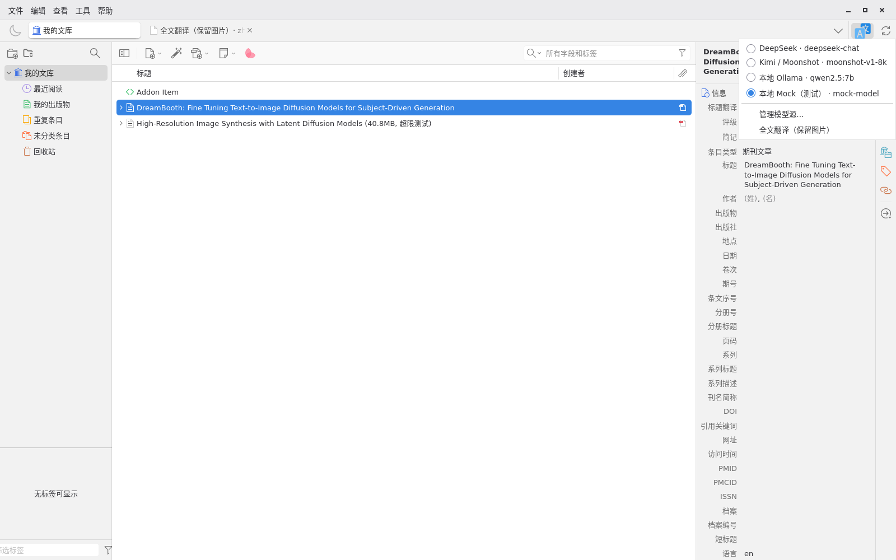

---

## 4. 全文翻译（保留图片）

把整篇 PDF 翻译成一个 HTML 附件：正文逐段对照翻译，图、表、行间公式以截图保留在原位置，图表标题也会翻译。

### 4.1 启动方式（任选其一）

- 在条目列表**右键**带 PDF 的条目 →「**全文翻译（保留图片）**」（可多选，依次翻译）
- PDF 阅读器工具栏的「**译全文**」按钮，或在 PDF 页面上右键 →「全文翻译（保留图片）」
- 快捷键 **Alt + Shift + F**（作用于当前打开的 PDF，或在列表中选中的条目）
- 菜单「工具 → Scholar Suite：全文翻译当前 PDF（保留图片）」

翻译使用「设置 → 翻译」里当前选择的翻译服务；启用了模型源时就是当前模型源。

### 4.2 进度与取消

右下角会弹出进度窗口，显示当前阶段（解析、截取图表、翻译 n/总数）和百分比。取消方法：

- 点进度窗口里的「**取消**」按钮；或
- 菜单「工具 → Scholar Suite：取消正在进行的全文翻译」。

取消后会等已经发出的请求返回再停止（通常几秒内），不会生成附件。同一时间只运行一个全文翻译任务。

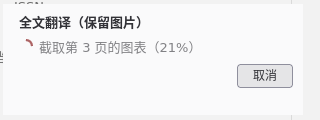

### 4.3 输出位置

完成后，在原条目下会多出一个**子附件**「全文翻译（保留图片）· zh-CN」（文件名形如 `原文件名.全文翻译.html`，存在 Zotero 数据目录的 storage 里，会随 Zotero 同步），并自动在 Zotero 里打开（可在设置里关掉「完成后自动打开译文」）。之后随时双击这个附件即可再次查看，也可以右键「在文件管理器中显示」后用浏览器打开。

### 4.4 显示模式

译文页面顶部有四个按钮，可随时切换：

- **中英对照**（默认）：原文段落下方紧跟译文
- **左右并排**：左原文、右译文
- **仅译文** / **仅原文**

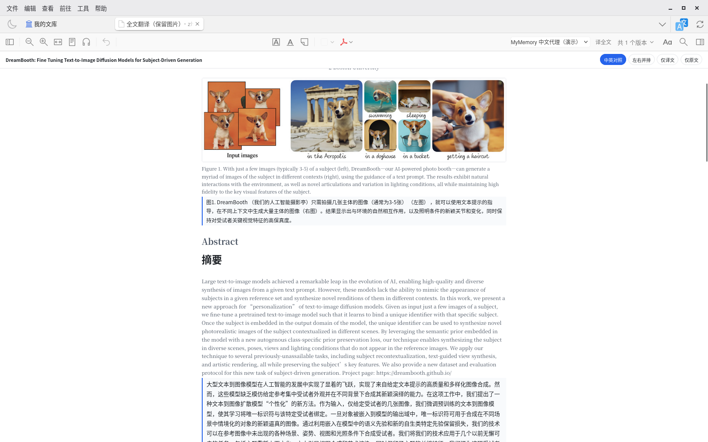
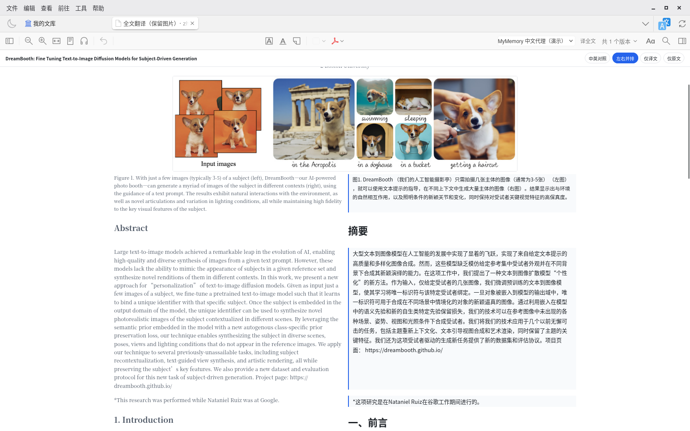
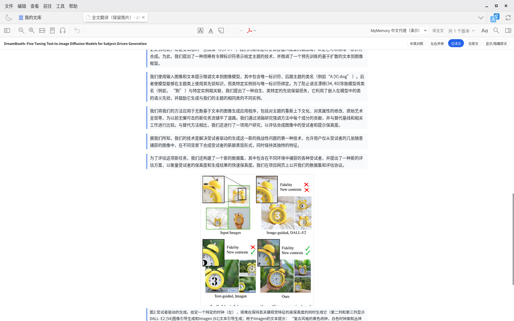

（截图为 DreamBooth 论文前 2 页的实际运行结果。为便于演示，翻译服务是一个指向免费机器翻译接口的 OpenAI 兼容模型源，译文质量取决于你所用的模型；接入 DeepSeek、Kimi 等大模型效果会更好。）

### 4.5 大小上限与其他设置

- 默认只处理 **30 MB 以内**的 PDF；超过会提示文件过大并停止。需要翻更大的文件，到「**设置 → 翻译 → Scholar Suite：全文翻译（保留图片）与模型源 → PDF 大小上限（MB）**」调高即可（对应偏好 `fullText.maxFileSizeMB`）。
- 同一页还可以设置：并发请求数（默认 4）、失败重试次数（默认 2）、图片清晰度（渲染倍数，默认 2×）、图片格式（自动 / PNG / JPEG）、行间公式是否以图片保留、完成后是否自动打开。

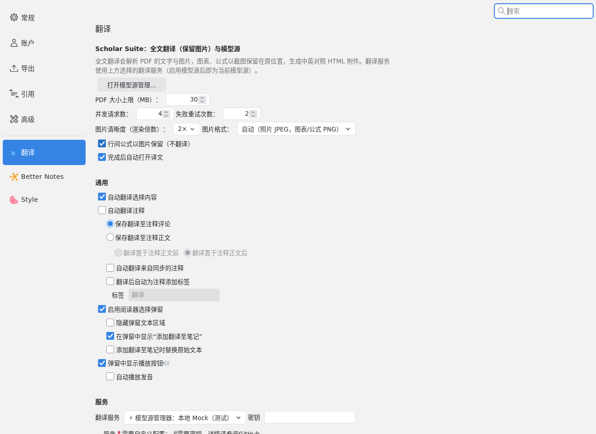

---

## 5. 图内文字翻译（1.1.0 新增）

全文翻译时，顺带把**图片和图表里的文字**（坐标轴、图例、表头、标注、截图里的字）翻成中文。译文以一个透明叠层显示在原图上，**原图本身不做任何修改或重绘**，随时可以切回原图。

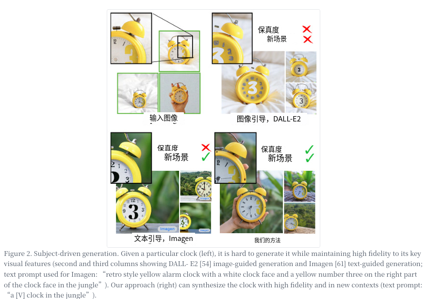

### 5.1 两种来源

| 来源 | 适用的图 | 需要什么 | 费用 |
|---|---|---|---|
| **矢量文字** | 用绘图软件导出的矢量图、表格（PDF 里文字本来就是文字） | 不需要额外配置，直接从 PDF 读取文字和坐标 | 免费（只消耗普通翻译请求） |
| **位图 OCR** | 照片、截图、扫描图等位图里的文字 | 一个支持图片输入的「识图模型源」 | **按图片计费**，默认关闭 |

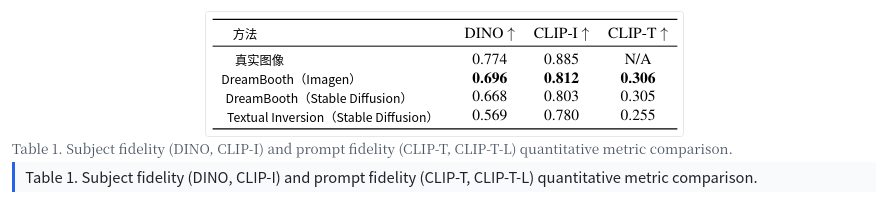

### 5.2 怎么用

1. 打开「**设置 → 翻译 → Scholar Suite：全文翻译（保留图片）与模型源 → 图内文字翻译**」。
2. 「**翻译图内文字（矢量图，免费）**」默认已勾选：之后每次全文翻译都会处理矢量图里的文字。
3. 需要识别照片、截图里的文字时，再勾选「**位图 OCR**」，并按 5.3 配置一个识图模型源。
4. 照常启动全文翻译（右键条目 →「全文翻译（保留图片）」等，见第 4 节）。进度窗口会多出「图内文字：识别 n/总数 · 翻译 n/总数」阶段，同样可以点「取消」。

   

5. 打开译文附件后，页面顶部右侧有「**图内文字：显示译文 / 显示原图**」两个按钮，可一键切换全部叠层；鼠标悬停在某一处译文上，会临时露出下面的原文。切换是纯 CSS 实现的，译文 HTML 里不含脚本，用浏览器打开也一样能切换。

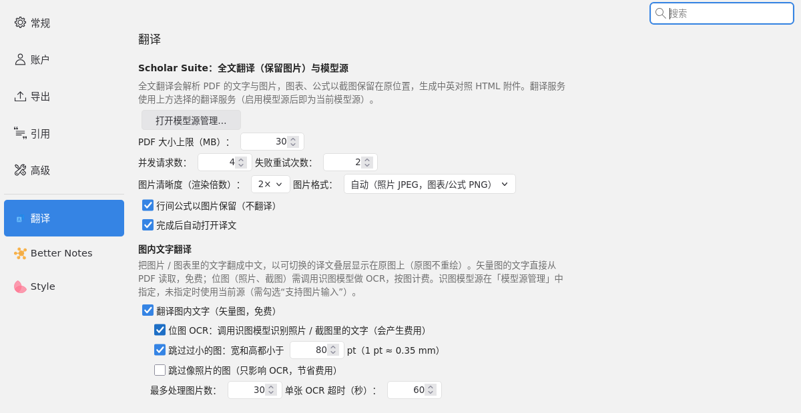

其他设置（同一页）：

- **跳过过小的图**：宽和高都小于设定值（默认 80 pt，约 2.8 cm）的图（图标、logo）不处理。
- **跳过像照片的图**（只影响 OCR）：照片类图片一般没有值得翻译的文字，勾选后可以省下 OCR 费用。
- **最多处理图片数**：默认 30，超过的图不再处理（防止长文档产生过多 OCR 请求）。
- **单张 OCR 超时**：默认 60 秒。超时或识图服务出错的图会被跳过、记在结果里，**不影响整篇翻译完成**，矢量文字照常叠加。

### 5.3 设置识图模型源

位图 OCR 用的是「模型源管理器」里的一个支持图片输入的模型。

1. 打开模型源管理器（Alt + Shift + M），点「**＋ 新增 ▾**」，在下拉菜单底部的「**识图模型源**」里选一个预设：

   | 预设 | 默认模型 | 说明 |
   |---|---|---|
   | **识图 · 智谱 GLM-4.6V-Flash（免费）** | `glm-4.6v-flash` | **推荐**。智谱开放平台的免费视觉模型，国内直连；到 open.bigmodel.cn 注册获取 API Key |
   | **识图 · 通义 Qwen-VL** | `qwen3-vl-flash` | 推荐的另一选择。阿里云百炼（DashScope），价格低，国内直连 |
   | 识图 · OpenAI | `gpt-5.4-mini` | 需要 OpenAI Key |
   | 识图 · Claude | `claude-haiku-5-5` | 需要 Anthropic Key |
   | 识图 · Gemini | `gemini-3.5-flash-lite` | 需要 Google AI Studio Key |

   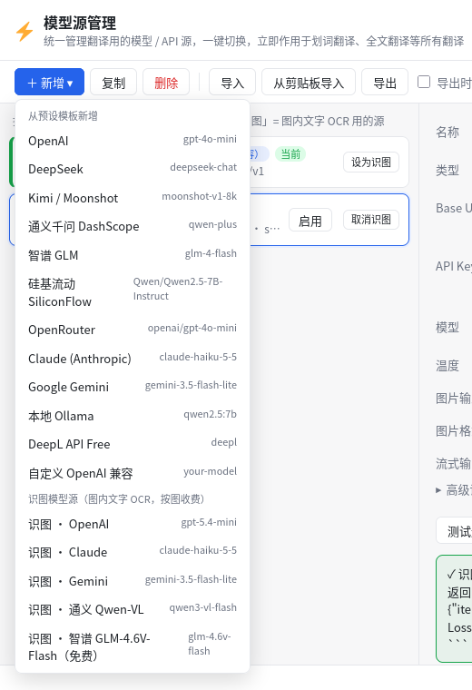

2. 填入 API Key，点「**保存**」。用预设新建的源会自动勾选「支持图片输入」并设好「图片格式」（各家传图片的格式不同，一般不用改）。
3. 点「**测试识图**」：会发一张内置的小测试图，期望识别出 “Input images” 与 “Prior Preservation Loss”，并显示耗时和模型返回的内容。
4. 在列表里点该源右侧的「**设为识图**」。列表中会显示橙色「识图」标签，窗口右上角显示「识图：xxx」。

   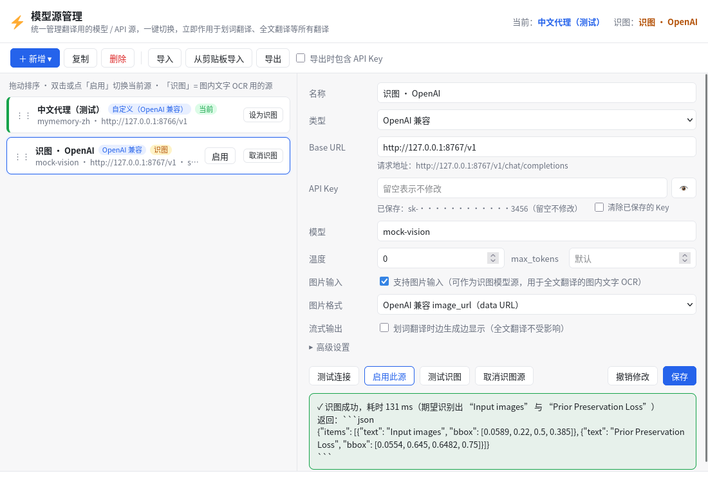

说明：

- **识图源和翻译源是分开的**：设为识图不会改变当前翻译服务（「当前」标记不动）；图内文字的**翻译**仍走当前翻译源，识图源只负责把图里的字和位置认出来。
- 没有单独指定识图源时，会尝试用当前翻译源识图，但前提是它在编辑区勾选了「支持图片输入」（DeepL 不支持）；否则跳过 OCR（译文页面顶部的说明里会写「位图 OCR 未执行」及原因），矢量文字照常处理。
- 其他 OpenAI 兼容的视觉模型也可以勾选「支持图片输入」后设为识图源（未逐一测试）。
- 「取消识图」可以撤销指定。

### 5.4 费用提示

- **位图 OCR 默认关闭**。开启后，每张需要 OCR 的图会向识图服务发送一次请求，**按图片（像素/token）计费**；图片会缩放到最长边约 1600 像素再发送。
- 一篇 20 多页、二十几张图的论文，大约是 20–30 次识图请求，另加少量图内文字的翻译请求。智谱 GLM-4.6V-Flash 目前免费（以智谱官方说明为准），其他服务请查看各自的价格页。
- 想省钱可以：勾选「跳过像照片的图」、调低「最多处理图片数」，或只开矢量文字（完全不产生识图费用）。
- 图片只会发送给你自己配置的识图服务，套件不经过任何第三方服务器。

### 5.5 限制

- **旋转的文字不处理**（例如竖排的纵坐标标题），保持原样。
- **OCR 的位置准确度取决于识图模型**：模型给出的文字框偏大或偏移时，译文叠层可能盖到旁边的图形或露出部分原文。套件会丢弃纯符号的识别结果（如把 ✓ 认成 “/”）、丢弃译文与原文相同的条目，并让叠层避开相邻的非文字图形，但不能完全避免。遇到这种情况点「显示原图」或悬停查看原文即可。
- **手写体识别效果差**，手写标注多半会被忽略或识别错误。
- 数字、单位、短的全大写缩写（如 FID、CLIP-I）、公式符号不翻译，保持原样。
- 叠层用的是近似字号，长译文会自动缩小或换行；极小的图里译文可能偏小。
- **五家识图接口（OpenAI、Claude、Gemini、通义 Qwen-VL、智谱 GLM）都还没有用真实 API Key 测试过**：请求格式是按各家文档实现并用本地模拟服务校验的，真实调用如遇报错，请把「测试识图」显示的错误信息反馈给我们。

---

---

## 6. 已知限制

1. **版面分析是启发式的**，大多数双栏论文效果良好，但可能出现：
   - 少量行内公式（夹在句子里的公式）被误判成图片截下来，或公式附近的文字被一起截进图里；
   - 论文首页的作者、单位行会原样居中显示、不翻译；但这依赖首页能识别到「Abstract / 1. Introduction」标题，个别排版特殊的论文仍可能把作者行当作正文翻译；
   - 个别表格的表头行被截在图外、变成单独一段文字；
   - 页眉页脚、脚注偶尔混入正文顺序。
   原文始终保留在译文旁边，遇到这些情况可以对照阅读。
2. **Ethereal Style 不在 Lite 版里**：需要另装官方版。Style 6.0.8 在 Zotero 10 上本身会在错误控制台留下一些报错（混淆代码中的 “is not a function” 和几条“调用了已移除的 API”警告），单独安装官方 Style、不装本套件时也一样，与本套件无关。
3. **本地完整版**：Style 6.0.8 带有防重新打包的自检。完整版原样保留它的文件和原 ID，目前运行正常（启动时控制台会有一条 Style 自检找不到自身的报错，无影响）；如果作者在未来版本中拒绝在合并包中运行，请改用 Lite 版 + 官方 Style。Ethereal Style 的会员/授权功能仍按作者的规则执行，本套件不做任何绕过。
4. **首次启动的 Better Notes 新手引导**：第一次启动时，Better Notes 可能显示新手引导遮罩并创建一条示例笔记，这是 Better Notes 原有行为。点「跳过/关闭」即可。
5. 全文翻译需要联网调用翻译服务（本地 Ollama 除外），长论文会产生较多请求，按量计费的 API 请留意用量。开启位图 OCR 后还会按图片产生识图费用（见 5.4）。
6. 图内文字翻译的限制见 5.5。五家识图接口尚未用真实 API Key 测试过。
7. 超过 30 MB 的提示框里写的设置路径是「设置 → 翻译 → 全文翻译（保留图片）」，实际分组标题是「Scholar Suite：全文翻译（保留图片）与模型源」。

---

## 7. 从源码构建

需要 Node.js 20+、npm、Python 3。

```bash
git clone https://github.com/wengu4765-lang/zotero-scholar-suite.git
cd zotero-scholar-suite
(cd src/pdf-translate && npm install)
(cd src/better-notes && npm install)

python3 build.py                 # Lite 版 → dist/zotero-scholar-suite-lite-1.1.0.xpi（另生成 dist/update.json）
python3 build.py --with-style    # 完整版 → dist/zotero-scholar-suite-full-1.1.0.xpi（仅供自用）
python3 build.py --skip-npm      # 子模块已构建过时，只重新组装
```

`--with-style` 会从 <https://github.com/MuiseDestiny/zotero-style/releases/download/6.0.8/zotero-style.xpi> 下载官方包（缓存在 `.cache/`），
校验 sha256 `752937a4bf07f5efa00001aabdc585241071302415fb650864dfaeab390f163b`（与官方 Release 页面公布的一致），不符就拒绝打包。
离线时可以用 `--with-style --style-xpi /path/to/zotero-style.xpi` 指定本地文件，同样会校验。

### 目录结构

| 路径 | 内容 |
|---|---|
| `master/` | 套件主 `bootstrap.js`（把生命周期事件分发给各子模块）、`suite.json`、默认偏好、图标、`LICENSE`、`NOTICE.md` |
| `src/pdf-translate/` | Translate for Zotero 2.4.8 源码 + 套件新增代码（`src/modules/scholar/`），保留原 LICENSE 与版权 |
| `src/better-notes/` | Better Notes for Zotero 3.3.3 源码（只改了 addonID），保留原 LICENSE 与版权 |
| `build.py` | 构建脚本 |
| `test/` | mock LLM / mock 识图 / 中文演示代理服务、Node 侧单元与全文测试、Zotero 内 e2e 脚本（`test/e2e/`） |
| `tools/` | 测试用 Zotero 启动脚本 `zrun.sh`、在运行中的 Zotero 里执行 JS 的 `zeval.py`、RDP 安装工具 |
| `docs/screenshots/` | 截图 |

### 测试

测试用的论文 PDF 体积较大，没有放进仓库，用脚本下载（也可以手动下载）：

- DreamBooth（arXiv 2208.12242，约 23 MB）：<https://arxiv.org/abs/2208.12242>，PDF：<https://arxiv.org/pdf/2208.12242>
- Latent Diffusion Models / LDM（arXiv 2112.10752，约 41 MB，用于“超过上限”提示测试）：<https://arxiv.org/abs/2112.10752>，PDF：<https://arxiv.org/pdf/2112.10752>

```bash
bash test/fetch-testdata.sh            # 下载到 testdata/，并用 ghostscript 生成第 1、2、5 页的截取版
(cd test && npm install)               # Node 侧测试依赖
node test/figtext-unit.mjs             # 图内文字单元测试

bash test/mock.sh                      # mock LLM（127.0.0.1:8765）
bash test/vision.sh                    # mock 识图（127.0.0.1:8767，需要 tesseract）
# 启动 Zotero（Xvfb）并装上打包好的 xpi；ZBIN 指向 Zotero 可执行文件，或 ZOTERO_TARBALL 指向官方 Linux 压缩包
ZOTERO_TARBALL=/path/to/Zotero-10.x_linux.tar.xz tools/zrun.sh fresh
python3 tools/zeval.py -f test/e2e/00-startup-check.js   # 启动自检
python3 tools/zeval.py -f test/e2e/01-setup-profiles.js  # 建模型源并启用 mock
python3 tools/zeval.py -f test/e2e/03-fulltext.js        # 全文翻译（后台）
python3 tools/zeval.py -f test/e2e/04-fulltext-result.js # 轮询结果
python3 tools/zeval.py -f test/e2e/14-ui-check.js        # 模型源管理器与偏好面板
```

> 务必用打包好的 `.xpi` 测试（`ADDON_DIR=dist/…xpi`），不要用解包目录：jar: 协议下的路径问题只有打包后才会暴露。

---

## 8. 许可证与致谢

- 本套件整体以 **GNU AGPL-3.0-or-later** 发布，完整许可证见 [`LICENSE`](LICENSE)，各组件来源与改动说明见 [`NOTICE.md`](NOTICE.md)。
- **Better Notes for Zotero**、**Translate for Zotero**：作者 **windingwind** 及贡献者（AGPL-3.0-or-later）。<https://github.com/windingwind/zotero-better-notes> 、<https://github.com/windingwind/zotero-pdf-translate>
- **Ethereal Style**：作者 **Polygon / MuiseDestiny**，版权归原作者所有，本仓库不包含其任何文件。<https://github.com/MuiseDestiny/zotero-style>
- 全文翻译使用 Zotero 自带的 pdf.js（Mozilla，Apache-2.0）解析 PDF。
- 感谢以上作者的出色工作。
